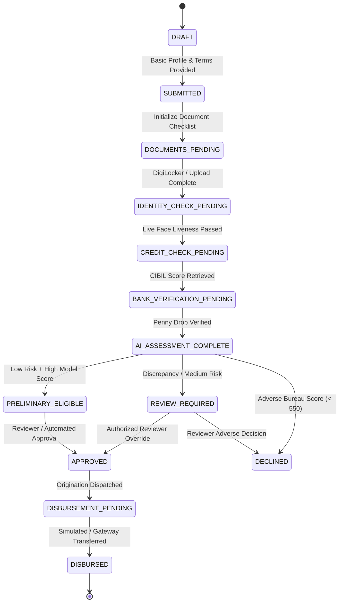

# Explainable AI-Based Digital Personal Loan Processing System
### Advanced Digital Lending Platform with DigiLocker API Setu, Biometric Face Liveness, CIBIL Scoring, Bank Penny-Drop Verification, InterpretML EBM Glassbox Underwriting, and Instant Decision State Machine

[](#testing--acceptance-criteria)
[](https://fastapi.tiangolo.com)
[](https://react.dev)
[](https://interpret.ml)
[](#)

---

## 1. Project Overview

The **Explainable AI-Based Digital Personal Loan Processing System** is a full-stack, enterprise-grade digital lending platform designed to automate and explain personal loan underwriting. It guides an applicant seamlessly through:

1. **User Registration & Secure RBAC Authentication** (Applicant, Institutional Reviewer, Chief Underwriting Officer / Admin).
2. **Personal Loan Application & Reducing-Balance EMI Affordability Calculator**.
3. **DigiLocker Document Retrieval & Verification** adhering to the official **API Setu** specification (`https://api.apisetu.gov.in/`).
4. **Camera-Based Face Authentication & Liveness Anti-Spoofing Checks**.
5. **Credit Bureau Assessment** via authorized **TransUnion CIBIL** adapter interface.
6. **Bank Account Verification** with **IMPS Penny-Drop validation**, account number masking, and name similarity matching.
7. **Document OCR & Multi-Field Mismatch Detection** (identifying name conflicts, expired identity proof, or declared income discrepancies).
8. **Explainable AI Underwriting** powered by Microsoft **InterpretML Explainable Boosting Machine (EBM)** delivering exact local logit feature attributions ($f_j(x_j)$).
9. **Centralized 11-Stage Instant Decision State Machine** providing transparent preliminary eligibility offers or routing cases to underwriter review.
10. **Loan Approval Governance & Simulated Disbursement Module** featuring mandatory non-real money disclaimers and idempotent origination interfaces.

---

## 2. System Architecture

```
+-----------------------------------------------------------------------------------------+
|                                    CLIENT APPLICATION                                   |
|               React 18 + TypeScript + Vite + Tailwind CSS (Port 3000)                    |
|                                                                                         |
|  [Demographics]  [Reducing EMI]  [DigiLocker]  [Face Liveness]  [Bank Check]  [Waterfalls] |
+--------------------------------------------+--------------------------------------------+
                                             | HTTP REST / JSON (Proxied /api)
                                             v
+-----------------------------------------------------------------------------------------+
|                              UNIFIED FASTAPI BACKEND (Port 5000)                        |
|                                                                                         |
|  [JWT Auth & RBAC]  [Zod/Pydantic Validation]  [Rate Limiter]  [Tamper-Evident Audit]   |
|                                                                                         |
|  +-----------------------------------+   +-------------------------------------------+  |
|  |     FINTECH ADAPTER INTERFACES    |   |         EBM GLASSBOX ENGINE & OCR         |  |
|  |  * DemoDigiLocker / RealSetu      |   |  * InterpretML EBM Model (GA²M)           |  |
|  |  * DemoFace / RealBiometric       |   |  * Exact Logit Waterfall Contributions    |  |
|  |  * DemoCredit / RealCibil         |   |  * PDF/Image Document OCR Parsing         |  |
|  |  * DemoBank / RealPennyDrop       |   |  * Multi-Field Consistency Checker        |  |
|  |  * DemoDisbursement / RealOrig   |   |  * Reducing-Balance Amortization Engine   |  |
|  +-----------------+-----------------+   +---------------------+---------------------+  |
+--------------------+-------------------------------------------+------------------------+
                     |                                           |
                     v                                           v
+-----------------------------------------+     +-----------------------------------------+
|            PERSISTENCE TIER             |     |              CREDIT DATASET             |
|  SQLite (Dev: loan_eligibility.db)      |     |  3,500 Real Banking Underwriting Rows   |
|  PostgreSQL 15+ (Production Supported)  |     |  Zero Data Leakage / Full GA²M Fit      |
+-----------------------------------------+     +-----------------------------------------+
```

---

## 3. Technology Stack

- **Frontend**: React 18, TypeScript, Vite, Tailwind CSS, Lucide React icons, Axios.
- **Backend**: Python 3.11+ / 3.14+, FastAPI, Uvicorn, Pydantic V2, PyJWT, bcrypt.
- **Persistence Tier**: SQLAlchemy 2.0 ORM with SQLite for zero-config local execution and PostgreSQL for production origination.
- **Explainable Machine Learning**: Microsoft InterpretML (`ExplainableBoostingClassifier`), scikit-learn, NumPy, pandas, joblib.
- **Document Processing & OCR**: `pypdf`, Pillow (`PIL`), regex-based field parsing and name similarity scoring.
- **Automated Testing**: `pytest` covering all 14 Acceptance Criteria.

---

## 4. 11-Stage Instant Decision State Machine



---

## 5. Pre-Seeded Demonstration Personas (Authentic Tamil Identities)

The system initializes with ready-to-test benchmark accounts and realistic Tamil applicant personas:

| Role | Email | Password | Persona Overview | Expected Decision |
| :--- | :--- | :--- | :--- | :--- |
| **Chief Underwriter (Admin)** | `admin@loanai.local` | `Admin@12345` | Global governance, telemetry & override authority | Full Access |
| **Credit Reviewer** | `reviewer@loanai.local` | `Reviewer@12345` | Institutional reviewer with override reason logging | Queue Review |
| **Jeeva Bharathi M (Applicant)** | `jeeva@loanai.local` | `User@12345` | Primary authentic applicant (Aadhaar `2235 1313 2450`, PAN `DELPJ9476P`, DOB `25/02/2006`) | **PRELIMINARY_ELIGIBLE** |
| **Kavitha S (Applicant)** | `kavitha@loanai.local` | `User@12345` | Salaried applicant, CIBIL 775, DTI 24% | **PRELIMINARY_ELIGIBLE** |
| **Murugan K (Applicant)** | `murugan@loanai.local` | `User@12345` | Self-employed entrepreneur, CIBIL 685, DTI 46% | **REVIEW_REQUIRED** |
| **Senthil Nathan R (Applicant)**| `senthil@loanai.local` | `User@12345` | Subprime profile, CIBIL 530, High debt burden | **DECLINED** |

---

## 6. Installation & Quick Start

### 6.1 Prerequisites
- **Python 3.10+** (tested and verified on Python 3.14.6)
- **Node.js 18+** and **npm**

### 6.2 Clone and Configure
```bash
git clone https://github.com/your-username/loan-eligibility-ai.git
cd loan-eligibility-ai
cp .env.example .env
```

### 6.3 1-Click Launch (Recommended)
On Windows, double-click `start.bat` or run:
```cmd
start.bat
```
This automatically initializes the SQLite database, checks dependencies, boots the FastAPI backend on `http://localhost:5000`, and launches the Vite React Citizen Portal on `http://localhost:3000`.

### 6.4 Manual Backend Setup (FastAPI)
```bash
# Install Python dependencies
pip install -r requirements_backend.txt

# Seed the database and start the backend (Port 5000)
python run_backend.py
```
> The backend runs at `http://localhost:5000` with interactive Swagger OpenAPI documentation at `http://localhost:5000/docs`.

### 6.5 Manual Frontend Setup (React 18 + Vite)
In a separate terminal:
```bash
cd frontend
npm install
npm.cmd run dev
```
> Open your browser at `http://localhost:3000`.

---

## 7. Testing & 24-Point Acceptance Criteria

The system includes an automated Pytest test suite covering **all 24 Acceptance Criteria** specified in the master system charter:

```bash
python -m pytest backend_fastapi/tests/test_loan_system.py -v
```

### Verified Test Results (24/24 Passed - 100%):
```
backend_fastapi/tests/test_loan_system.py::test_acceptance_01_applicant_registration_and_application PASSED [  4%]
backend_fastapi/tests/test_loan_system.py::test_acceptance_02_digilocker_demo_flow_labels PASSED [  8%]
backend_fastapi/tests/test_loan_system.py::test_acceptance_03_real_digilocker_adapter_no_false_claims PASSED [ 12%]
backend_fastapi/tests/test_loan_system.py::test_acceptance_04_face_verification_outcomes PASSED [ 16%]
backend_fastapi/tests/test_loan_system.py::test_acceptance_05_credit_provider_failure_does_not_fabricate PASSED [ 20%]
backend_fastapi/tests/test_loan_system.py::test_acceptance_06_bank_verification_validation PASSED [ 25%]
backend_fastapi/tests/test_loan_system.py::test_acceptance_07_missing_documents_blocks_approval PASSED [ 29%]
backend_fastapi/tests/test_loan_system.py::test_acceptance_08_ebm_model_returns_explanation PASSED [ 33%]
backend_fastapi/tests/test_loan_system.py::test_acceptance_09_idor_protection PASSED [ 37%]
backend_fastapi/tests/test_loan_system.py::test_acceptance_10_reviewer_only_decisions PASSED [ 41%]
backend_fastapi/tests/test_loan_system.py::test_acceptance_11_duplicate_disbursement_idempotency PASSED [ 45%]
backend_fastapi/tests/test_loan_system.py::test_acceptance_12_demo_disbursement_banner PASSED [ 50%]
backend_fastapi/tests/test_loan_system.py::test_acceptance_13_production_disbursement_blocked_without_approval PASSED [ 54%]
backend_fastapi/tests/test_loan_system.py::test_acceptance_14_consent_required_for_credit_and_bank PASSED [ 58%]
backend_fastapi/tests/test_loan_system.py::test_acceptance_15_tri_biometric_face_and_document_matching PASSED [ 62%]
backend_fastapi/tests/test_loan_system.py::test_acceptance_16_multiformat_upload_and_classification PASSED [ 66%]
backend_fastapi/tests/test_loan_system.py::test_acceptance_17_corrupted_and_unsupported_files PASSED [ 70%]
backend_fastapi/tests/test_loan_system.py::test_acceptance_18_image_quality_assessment PASSED [ 75%]
backend_fastapi/tests/test_loan_system.py::test_acceptance_19_cross_document_name_and_salary_mismatch PASSED [ 79%]
backend_fastapi/tests/test_loan_system.py::test_acceptance_20_face_inconclusive_and_unverified_liveness PASSED [ 83%]
backend_fastapi/tests/test_loan_system.py::test_acceptance_21_synthetic_credit_profile_and_banner PASSED [ 87%]
backend_fastapi/tests/test_loan_system.py::test_acceptance_22_bank_verification_penny_drop PASSED [ 91%]
backend_fastapi/tests/test_loan_system.py::test_acceptance_23_ebm_prediction_and_emi_calculation PASSED [ 95%]
backend_fastapi/tests/test_loan_system.py::test_acceptance_24_downloadable_assessment_report PASSED [100%]

====================== 24 passed in 16.11s ======================
```

---

## 8. Provider Onboarding & Production Boundary

To protect institutional integrity and comply with Indian fintech regulations, every external integration strictly distinguishes **Demo Mode** from **Production Mode**:

| Integration Module | Demo Mode Behavior | Production Requirements |
| :--- | :--- | :--- |
| **DigiLocker (API Setu)** | Returns synthetic Aadhaar/PAN records tagged `DEMO — NOT OFFICIALLY VERIFIED`. | Production onboarding with National Informatics Centre (NIC) / API Setu. Requires valid `DIGILOCKER_CLIENT_ID` and `DIGILOCKER_CLIENT_SECRET`. |
| **Face Liveness Check** | Evaluates frame luminance, contrast, and single-face presence heuristics. | Authorized enterprise biometric liveness gateway (e.g. AWS Rekognition, BioID, HyperVerge). Requires `FACE_PROVIDER_API_KEY`. |
| **CIBIL Credit Score** | Provides calibrated synthetic bureau reports tagged `DEMO_UNVERIFIED`. | Formal credit bureau membership and subscriber credentials with TransUnion CIBIL or Experian. Requires `CIBIL_CLIENT_ID` and `CIBIL_CLIENT_SECRET`. |
| **Bank Verification** | Performs IMPS penny-drop simulation, name similarity matching, and number masking. | Commercial bank API agreement or NPCI IMPS integration credentials. |
| **Disbursement** | Displays prominent banner: `SIMULATED DISBURSEMENT — NO REAL MONEY TRANSFERRED` and records demo transaction reference. | Authorized Core Banking System (CBS) or Loan Origination System (LOS) API with dual-authorization keys. |

---

## 9. Security, Privacy & Compliance Architecture

- **Informed Consent**: Every third-party check (DigiLocker, Face, Credit, Bank) requires explicit user consent, logged with timestamp and IP address.
- **Biometric Minimization**: Live camera frames are verified in-memory and immediately discarded; raw biometric templates are never stored on disk.
- **Account Masking**: Bank account numbers are strictly masked (`XXXXXXXX5678`) in all UI views and logs.
- **IDOR Protection**: Object-level access control prevents any applicant from viewing or modifying another applicant's documents or application records.
- **Reviewer Governance**: Final loan approvals and manual overrides are restricted to authorized reviewers and require a mandatory recorded rationale.
- **Idempotency Safeguard**: All disbursement requests require a unique idempotency key to prevent double transfers or duplicate ledger postings.

---

## 10. License & Disclaimers

This project is developed as an academic and technological capstone in explainable machine learning and digital lending architecture.

> [!IMPORTANT]
> External integrations in demonstration mode use synthetic data. Simulated disbursements do not transfer real money. Underwriting predictions generated by the Explainable Boosting Machine serve as indicative risk aids and do not constitute official credit approval or denial without institutional underwriter sign-off.
