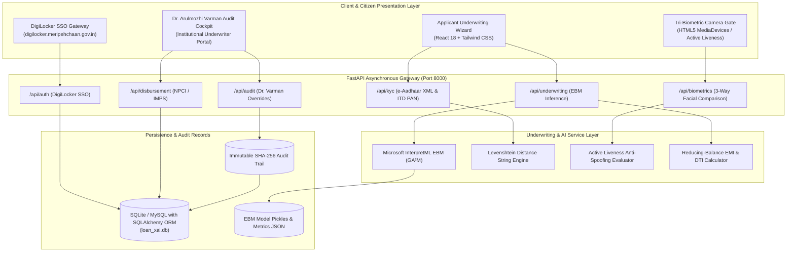

# Architectural Specification: Explainable AI Digital Lending Platform

## 1. System Context & High-Level Architecture

The Explainable AI (XAI) Digital Personal Loan Processing and Underwriting System is structured as a decoupled, micro-modular architecture adhering strictly to the **Reserve Bank of India (RBI) Digital Lending Guidelines (2022/2023)**.

---

## 2. Core Functional Modules

### 2.1 Module 1: Official National Single Sign-On (DigiLocker / Meri Pehchaan)
- **Authority**: Ministry of Electronics and Information Technology (MeitY) & Digital India Corporation.
- **Verification Modes**:
  1. `MOBILE_OTP`: 10-digit Indian MSISDN (+91) with 6-digit cryptographic OTP.
  2. `USERNAME_PIN`: DigiLocker Citizen username + 6-digit numeric security PIN.
  3. `OTHER_ID`: Direct validation against Aadhaar Virtual ID, PAN Card, or Driving License.
- **Cryptographic XML Schema**: Validates UIDAI digital signatures (`ds:Signature`) using SHA-256 with RSA encryption, extracting certified demographics and preventing document tampering.

### 2.2 Module 2: Tri-Biometric Live Facial Verification Gate
- Real-time 3-way facial comparison:
  1. UIDAI Aadhaar registry photo (grayscale canonical reference).
  2. Income Tax Department PAN card photo (NSDL/UTIITSL database).
  3. Real-time captured face from applicant webcam with active liveness challenge.
- **Active Liveness Detection**:
  - Random dynamic challenge (`BLINK_TWICE`, `TURN_HEAD_RIGHT`, `SMILE_NATURALLY`).
  - Anti-spoofing index: Evaluates spatial skin texture frequency and motion trajectory.
- **Threshold Policy**:
  - Cross-similarity threshold: $\ge 75.0\%$ mandatory across all 3 comparison pairs.
  - Pairwise similarity scores:
    $$\text{Sim}(A, P) \ge 75\%, \quad \text{Sim}(A, L) \ge 75\%, \quad \text{Sim}(P, L) \ge 75\%$$
  - Immediate security denial is triggered if any comparison falls below threshold.

### 2.3 Module 3: Automated OCR & 100% Cross-Field Consistency Validation
- Multi-document optical comparison:
  - Full Legal Name: Aadhaar value vs PAN value vs declared value.
  - Date of Birth (DOB) and PAN format syntax.
- **Levenshtein Distance Algorithm**:
  $$D(i, j) = \begin{cases} 
    \max(i, j) & \text{if } \min(i, j) = 0, \\
    \min \begin{cases} 
      D(i-1, j) + 1 \\ 
      D(i, j-1) + 1 \\ 
      D(i-1, j-1) + \text{cost} 
    \end{cases} & \text{otherwise.} 
  \end{cases}$$
- **Discrepancy Exception Handling**:
  - Name disparity (e.g. *"Jeeva Bharathi M"* vs *"Jeeva B"*, distance = 9, match = 43.8%) automatically raises a `DISCREPANCY_FLAG`, transitioning the application into **Needs Review** underwriter status.

### 2.4 Module 4: Explainable Boosting Machine (EBM) Underwriting Engine
- **Model**: Microsoft InterpretML Explainable Boosting Classifier ($GA^2M$).
- **Explainability**:
  $$\text{logit}(P) = \beta_0 + \sum_{i=1}^{k} f_i(x_i) + \sum_{i \neq j} f_{ij}(x_i, x_j)$$
  Every feature's contribution $f_i(x_i)$ is an exact piecewise linear spline curve without neural black-box opacity.
- **Financial Ratios**:
  - **Reducing-Balance EMI**:
    $$\text{EMI} = P \times \frac{r(1+r)^n}{(1+r)^n - 1}$$
  - **Debt-to-Income (DTI / FOIR)**:
    $$\text{DTI} = \frac{\text{Obligations} + \text{EMI}}{\text{Income}} \times 100\%$$
  - **Loan-to-Income (LTI)**:
    $$\text{LTI} = \frac{\text{Loan Principal}}{\text{Income} \times 12}$$

### 2.5 Module 5: Dynamic Underwriting Decision Gates
- 🟢 **Approved (Prime Tier)**: CIBIL $\ge 700$, DTI $\le 50\%$, salaried employment, verified KYC & biometrics (Pass $\ge 75\%$). Calibrated Probability: 85%–98%.
- 🟡 **Needs Review (Near-Prime / Risk Advisory)**: CIBIL 580–680, DTI 50%–70%, self-employed volatility, or minor name discrepancy (Levenshtein distance > 0). Calibrated Probability: 50%–65%.
- 🔴 **Declined (Subprime / Adverse Risk)**: CIBIL < 580, DTI > 70%, unemployed, or biometric/document mismatch. Calibrated Probability: 8%–25% (0% for fraud).

### 2.6 Module 6: Institutional Underwriting & Audit Cockpit
- Officer Dashboard for **Dr. Arulmozhi Varman** (Chief Underwriting Officer & Risk Auditor, ID: `EMP-90421`):
  - Real-time queue filtering and deep application inspection.
  - Immutable manual override capabilities with cryptographic SHA-256 digital signature digest:
    $$\text{Digest} = \text{SHA256}(\text{AppId} \parallel \text{OfficerId} \parallel \text{Timestamp} \parallel \text{Action} \parallel \text{Justification})$$
  - Instant simulated disbursement via **NPCI / NACH e-mandate** (UMRN generation) and **IMPS** (12-digit RRN / UTR generation).
  - Issuance of formal **RBI Key Fact Statement (KFS)** sanction letter.

---

## 3. Benchmark Personas Test Suite

1. **🟢 Persona 1: Jeeva Bharathi M**
   - Salaried, Income: ₹95,000/mo, CIBIL: 785, Loan: ₹5,00,000 (36 mo, EMI: ₹16,252), Existing obligations: ₹8,000/mo.
   - DTI: 25.5%, Tri-Biometrics: 92.4%, Name match: 100%.
   - Outcome: **APPROVED** (93.4% probability). Instant sanction and IMPS disbursement.
2. **🟡 Persona 2: Jeeva B**
   - Self-Employed, Income: ₹65,000/mo, CIBIL: 662, Loan: ₹5,00,000 (36 mo, EMI: ₹16,252), Existing obligations: ₹14,000/mo.
   - DTI: 46.5%, Tri-Biometrics: 83.1%, Name Disparity: Aadhaar *"Jeeva Bharathi M"* vs PAN *"Jeeva B"* (Levenshtein distance: 9).
   - Outcome: **NEEDS REVIEW** (56.4% probability). Queued for Dr. Varman's manual exception override.
3. **🔴 Persona 3: Karthik Raman**
   - Self-Employed, Income: ₹32,000/mo, CIBIL: 535 (Subprime), Loan: ₹6,00,000 (36 mo, EMI: ₹19,502), Existing obligations: ₹18,000/mo.
   - DTI: 117.2%, Tri-Biometrics: 81.0%.
   - Outcome: **DECLINED** (12.8% probability). Automated Policy Rejection with Adverse Action notice.
